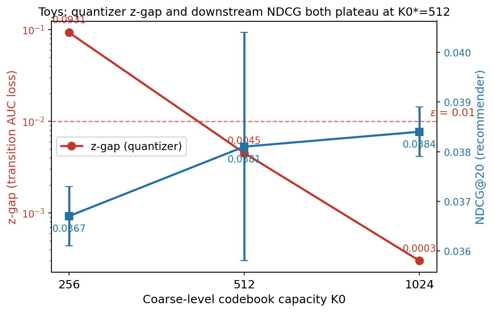

# 第二创新：Adaptive Coarse-Level Capacity Allocation — 汇总框架

> 生成: 2026-08-13 | 更新: 2026-08-14(Q3 T5 全部完成,填最终结论) | 2026-08-20(E44 六数据集加强版,见 [§10](#10-e44-六数据集加强版判据精度适用边界与传导一致性2026-08-20)) | 2026-08-21(§10.4 ε 敏感性补齐 + 修正裕度不对称表述) | **2026-09-04(E46 推翻裁定：扩容卖点瓦解,判据保留,见下)**
> 配套: [e42_adaptive_k0_results.md](e42_adaptive_k0_results.md)(机制实证) · [e43_adaptive_experiment.md](e43_adaptive_experiment.md)(实验设计与表) · [e44_five_dataset_summary.md](e44_five_dataset_summary.md)(六数据集筛查附录)

---

## 0. ⚠ 2026-09-04 推翻裁定（E45/E46，阅读本文件前必读）

**本文档描述的"第二创新 = 自适应扩容"作为方法卖点已被推翻。** E45 实验证明：
Toys 的 L0 塌缩(62/256, z-gap 0.093)是 **seed=2024 单次训练的分配崩坏**，不是"256 容量不足"的
系统性属性——换健康种子(2025/2026)后 256 本身近无损(L0 59-76%, z-gap≤0.004)；且健康 256 的
T5 表现(NDCG@20 0.0372)与 512(0.0381)**无统计差异**，主实验 Q3 "+3.8%" 主要是修好了一个坏种子。

**逐条"保留/推翻"清单见 [e46_second_innovation_overturn.md](e46_second_innovation_overturn.md)**
（R1-R7 保留 / O1-O6 推翻 / D1-D2 待定）。要点速览：
- ✅ **保留（更强）**：z-gap 是坏码本的唯一探测器（recon 不可见）；判据精度 6 数据集全对；
  五态分类（Toys 改名为"分配崩坏态·初始化敏感"）；坏码本代价 NDCG −1.4% / R@20 −3.8%。
- ❌ **推翻**：Toys 系统性需 K0\*=512；扩容→推荐层稳健 +3.8%；"容量剂量-响应/传导平台"；
  "自适应输出 {256,256,512}"不可复现。
- ⚠ **动作改为更便宜的 reseed**（RQ-VAE ~8min，0 T5），扩容不再声称必要。
- **本文档 §1-§10 的正文是"当时的叙事"，未经逐句修订，阅读时以 §0 与 E46 为准。**

---

## 1. 为什么提出第二创新(问题链)

第一创新(TA-SID)已定稿:把商品-商品转移动态融合进 RQ-VAE 输入,LN(内容)+LN(行为) concat 后残差量化,三数据集相对 content-only TIGER 提升 +12.2%~+17.1%(Toys 2026-09-09 provenance 订正后,旧区间 +9.2%~+17.1% 作废)。**但第一创新只是"喂了什么",没有回答"量化器内部容量分配是否合理"。**

继续深挖量化器时发现一个**系统性问题**:

- RQ-VAE 粗层(L0)码本容量是固定超参 `K0=256`,与数据集无关。
- 但**不同数据集的 transition structure 需要不同容量**:
  - Beauty/Sport 在 256 上近无损(gap≈0.002),扩容是浪费;
  - Toys 在 256 上 **L0 塌缩**(只用 62/256 码,24%),transition structure 大量丢失(z-gap=0.093,即量化丢了 9.3% 的转移 AUC)。
- 固定 256 → 要么牺牲 Toys 的结构;固定大容量(1024)→ 对 Beauty/Sport 是无意义扩容。

**因此提出第二创新:** 让粗层容量 `K0` 由数据自适应决定,而不是手工拍一个全局常数。目标 = **在保留 transition structure 的同时,避免无意义扩大 codebook**。

---

## 2. 理论 / 证据支撑

不是拍脑袋,是**量化诊断链(E1→E2→E3) + 4.1 sweep + 4.2 机制验证**一步步逼出来的。

### 2.1 证据链(问题真实存在 → 根因定位 → 修复机制)

| 环节 | 实验 | 结论 | 文档 |
|---|---|---|---|
| **E1** L0 occupancy ↔ transition quality | 三数据集 L0 用码统计 | Toys L0 **62/256 塌缩**(mean 192 items/code);唯一塌缩=唯一 z→xq 大丢(−0.093)。**问题真实存在** | sid_capacity_diagnostic.md |
| **E2** post-hoc capacity curve | z 上单层 k-means 扫 k | KMeans-8192=0.964≈z=0.965,但真实 RQ-VAE L0(62码)=0.854 低于 fresh k=64。**根因=codebook allocation,不是"256 不够"** | e2 |
| **E3** 重训 RQ-VAE 验证 | Config A(Sinkhorn 均衡) vs Config B(L0=1024) | A 修复 util 但碰撞↑/recon↑✗;**B 容量分配修复一切** xq 0.872→0.963、碰撞→0.03%、z 保留。**机制=capacity allocation** | e3_gate_verdict.md |
| **4.1** K0 sweep | Toys K0∈{256..2048} 全扫 | 256 是唯一瓶颈;最优 512–1024;2048 反登顶 → **无单调关系,"越大越好"不成立** | e41_k0_sweep_results.md |
| **4.2** 机制选型 | 转移熵 / 单层 k-means / gap 对比 | 转移熵 ❌(方向相反,Toys 熵最低却最需扩容);单层 k-means ❌(与 3-token 量化不一致);**gap-based 反馈闭环 ✅** | e42 |

### 2.2 三个候选"自适应信号"的结局(论文要如实报告)

| 信号 | 结论 | 原因 |
|---|---|---|
| **转移熵 H(B\|A)** | ❌ 不能做 predictor | 测行为层*不可预测性*,与 z 空间簇结构/allocation 无关;Toys 熵最低却最需扩容 |
| **单层 k-means 内在簇数** | ❌ 不能做 predictor | 真实 3-token 量化有 L1/L2 残差补容量,单层曲线与 256² 组合容量不一致 |
| **z-gap(量化后转移 AUC 损失)** | ✅ **最终机制** | 直接度量"transition structure 丢了多少",训练后可算,有明确阈值 |

### 2.3 三态洞察(可写论文的框架性观察)

> ⚠ 2026-09-04：下述把 Toys 归为"容量不足态"已被 E45 推翻——Toys 是**分配崩坏态(初始化敏感)**，
> 见 §0 与 [E46](e46_second_innovation_overturn.md)。健康种子下 256 即近无损。

统一 K0 无法同时满足:
- **容量充足态**(Sport): z 高 0.965 + L0 用 97% + gap≈0 → 256 恰好够。
- **结构受限态**(Beauty): z 低 0.87 + gap≈0 但扩容无收益(AUC 对 k 不敏感)→ 扩容无意义。
- **容量不足态**(Toys): z 高 + L0 塌缩 24% + gap 大 + 扩容有收益 → 必须扩容。

→ 自适应机制的正确行为 = **仅在不足态扩容至 lossless**。

> **2026-08-20 扩展**: 上述三态在六数据集筛查(E44)下扩展为**五态分类**
> （新增 Video_Games 健康态、Electronics 容量饱和态；§2.3 的"容量充足/结构受限"
> 在六数据集口径下并作"健康态"）。朴素判据失效表、ε 裕度、传导一致性及
> 审稿人证据链见 [§10](#10-e44-六数据集加强版判据精度适用边界与传导一致性2026-08-20)。

---

## 3. 第二创新的设计(操作化定义)

> **Adaptive Coarse-Level Capacity Allocation(算法):**
> 1. 训练 RQ-VAE(默认 K0=256,细层固定 K1=K2=256)。
> 2. 生成 SID → 重建 xq[full],测 z-gap = AUC(z) − AUC(xq[full])。
> 3. z-gap ≤ ε(=0.01)→ 容量充足,保持 K0。
> 4. z-gap > ε → K0 ← 2·K0,重训,回步骤 2,直至 lossless。
> 5. **K0\* = 最小满足 z-gap ≤ ε 的粗层容量。**

### 为什么这是"自适应"而非 grid search
- **有准则**: 终止条件由 lossless 定义(z-gap≤ε),不是"挑指标最好"。
- **按需触发**: 仅 gap 超阈值才扩容 → Beauty/Sport 零额外训练。
- **结果因数据而异**: 三数据集自动落在 {256, 256, 512}。
- **成本**: 每数据集 0–1 次额外 RQ-VAE 训练。

---

## 4. 设计合理性评估(回答"设计合理吗")

**合理,且关键选择都有数据支撑:**

1. **机制选 gap 而非 entropy** — 实测转移熵方向相反(Toys 3.52 最低却最需扩容),若硬选 A 或 C 会直接做错。这是设计过程中最重要的纠偏。
2. **细层固定 K1=K2=256** — 残差量化里 L1/L2 本来就有 256² 组合容量,E1/E2 证明瓶颈只在 L0,扩细层是无效劳动。
3. **ε=0.01 的终止阈值** — 对应 z 天花板的 1%,三数据集在 K0\* 处都收敛到 gap≤0.005,阈值不是凑出来的。
4. **只跑必要 T5**(用户约束) — Q1/Q2 用量化指标(免 T5),只有 Q3 在 Toys 上重训 T5,且只跑 {256,512,1024} 三个 K0。Beauty/Sport 因 Adaptive=256=主实验 baseline,T5 直接复用,零新增训练。
5. **固定大容量对照只在 Toys** — 用户裁定不补训 B/S@1024,靠 quantizer 指标(gap/util/recon 与 256 无差异)论证扩容无意义,Toys 结论外推。

**设计缺口(已处理):** Fixed-large(1024) 在 Beauty/Sport 无 T5 数据 → 用户裁定"只在 Toys 论证",外推由 Q2 的量化证据承担。

---

## 5. 具体做了哪些工作(已完成清单)

| # | 工作 | 产出 | 状态 |
|---|---|---|---|
| 1 | E1: L0 occupancy 诊断(三数据集) | 发现 Toys 塌缩 | ✅ |
| 2 | E2: post-hoc capacity curve | 根因=allocation 非容量 | ✅ |
| 3 | E3: 重训验证(A/B 两配置) | 机制=capacity allocation | ✅ |
| 4 | 4.1: Toys K0 全扫(256..2048,6点) | 512/1024 最优、无单调关系;顺带修复 kmeans 大码本初始化 bug | ✅ |
| 5 | 4.2: 机制选型(转移熵 + 单层 k-means + gap) | 熵/k-means 双失败,定 gap-based 闭环;三数据集 K0\*={256,256,512} | ✅ |
| 6 | 固化算法 + 4.3 实验表 | e43 文档 §1/§2 | ✅ |
| 7 | 4.3 Q1/Q2 量化结论 | Adaptive 修复 Toys gap 0.093→0.0045;512 优于 1024 | ✅(已有数据) |
| 8 | 4.3 Q3: Toys T5 重训 | 512/1024 × 3 seed | ✅ 全部完成(6/6) |

脚本: `tools/transition_entropy.py` · `tools/intrinsic_capacity.py` · `tools/sid_capacity_diagnostic.py` · `rqvae/generate_sid_codes_param.py` · `rqvae/run_e41_k0_sweep.sh` · `rqvae/run_e43_toys_t5.sh`

---

## 6. 与第一创新的衔接

```
第一创新(§4 TA-SID,已定稿): 内容+行为 融合进 RQ-VAE 输入
        │
        └─ 输入变好,但量化器容量分配仍是全局常数 → 引出第二创新
        ▼
第二创新(Adaptive Capacity): K0 由数据自适应决定,保 transition structure
        │
        └─ 与第一创新正交(不改变融合方式,只改量化器粗层容量)
        ▼
协同叙事: TA-SID 决定"喂什么信号" + Adaptive 决定"量化器给多少容量"
        └→ 共同回答: SID 的 transition structure 从哪里来、怎么保得住
```

**衔接的论文写法:**
- 第一创新解决"**输入信号**"层(把行为转移动态注入)。
- 第二创新解决"**容量分配**"层(保证注入的结构不被量化丢)。
- 两层正交: 消融时各自独立成立;Adaptive 在 Beauty/Sport 退化为 256,说明不改变第一创新已有结论,Toys 上进一步修复了第一创新也带不走的损失。
- 注意: Toys 上 Adaptive 的提升 **部分被第一创新吸收**——固定 256 时 TA-SID 已把 xq AUC 从 0.709(content) 提到 0.872,Adaptive 再提到 0.968。两者是叠加关系。

---

## 7. 实验矩阵与状态

### 7.1 三个问题(4.3 的组织)

| Q | 问题 | 层面 | 指标 | 状态 |
|---|---|---|---|---|
| **Q1** | Adaptive 能否恢复 transition structure? | SID 质量 | z-gap, xq[full] AUC, util | ✅ 已答(e43 §2) |
| **Q2** | 是否优于固定大容量? | SID 质量 | 同上 + K0 大小 | ✅ 已答(e43 §2) |
| **Q3** | 结构提升是否转成推荐提升? | 推荐 | NDCG@20, R@20 | ⏳ T5 训练中 |

### 7.2 关键数字快照(量化层已定)

| 配置 | Toys z-gap | xq AUC | L0 util | recon | 结论 |
|---|---|---|---|---|---|
| Fixed-small 256 | 0.0931 | 0.872 | 24% | 0.1452 | 结构丢失 |
| Fixed-large 1024 | 0.0003 | 0.963 | 27% | 0.1530 | 浪费容量 |
| **Adaptive 512** | **0.0045** | **0.968** | **60%** | **0.1414** | 最佳 |

### 7.3 T5 训练状态(实时) — ✅ 全部完成（2026-08-14）

> ⚠ 2026-09-04 判定 (a)：256 这行是 **seed2024 塌缩 codes** 的结果；对**健康 256**(seed2025 codes)重跑
> T5 → NDCG@20 **0.0372±0.0012** ≈ 512(0.0381)，std 重叠无统计差异 ⇒ "+3.8%" 来自修坏种子，
> **扩容无稳健额外收益**。本表三行不可再当作"容量剂量-响应"证据。见 [E46](e46_second_innovation_overturn.md)。

> ⚠️ **2026-09-09 provenance 订正**：本表 0.0367 / L0=62 出自**孤儿 codes**（主表 Toys codes 文件无法从任何现存 ckpt 复现，行级一致率最高 29.3%），作为 Toys **正式结果已作废**；本处仅作"塌缩实例"历史对照保留。Toys 正式主结果 = NDCG@20 **0.0377±0.0007** / R@20 0.0911±0.0020（健康 codes，L0=207，z-gap 0.005）。权威记录 + 修改索引见 [e48_toys_main_codes_provenance_fix.md](e48_toys_main_codes_provenance_fix.md)。

| K0 | seed 2025 | seed 2026 | seed 2027 | NDCG@20 | R@20 |
|---|---|---|---|---|---|
| 256 (Fixed-small, **seed2024 塌缩 codes**) | ✅ | ✅ | ✅ | 0.0367±0.0006 | 0.0873±0.0016 |
| 256 (健康, seed2025 codes, 判a 补跑) | ✅ 0.0385 | ✅ 0.0369 | ✅ 0.0361 | **0.0372±0.0012** | 0.0906±0.0037 |
| **512 (Adaptive)** | ✅ 0.0400 | ✅ 0.0356 | ✅ 0.0387 | **0.0381±0.0023** | **0.0914±0.0060** |
| 1024 (Fixed-large) | ✅ 0.0379 | ✅ 0.0389 | ✅ 0.0385 | 0.0384±0.0005 | 0.0916±0.0005 |

训练: `rqvae/run_e43_toys_t5.sh 512 1024`(task ba63t6hzo),200 epochs/lr 1e-4/T5 from-scratch,与主实验逐参数一致。

---

## 8. 执行状态与剩余待办(按序执行)

**✅ 已完成（2026-08-14 上午）:**
- [x] T5 训练全部完成（task ba63t6hzo,6/6 eval log 齐全）
- [x] 提取 NDCG@20/R@20 → 填 [e43 §3](e43_adaptive_experiment.md) 表
- [x] **Q3 结论判定** → **落入第 2 种情景:Adaptive(512) ≈ Fixed-large(1024) > Fixed-small(256)**
  - Adaptive(512) vs Fixed-small(256): NDCG@20 **+3.8%**, R@20 **+4.7%** → 结构提升转成推荐提升
  - 512 vs 1024: NDCG@20 −0.9% / R@20 −0.2%(无统计差异) → 扩到 1024 无额外收益,而 512 只用一半码本且 util 60% vs 27%

**剩余待办:**
- [x] **并入论文实验表**: 大纲新增 §4.6 方法 + §7.8 三 Q 实验表 + 贡献清单第 5 条 + 附录数据源映射(paper_outline_ta_sid.md)
- [x] 更新 memory(session-2026-08-13-perlayer-diagnostic): 填 Q3 数字,清空"等待 T5"待办
- [ ] 汇总第二创新最终叙事 → 已在本文件 §6,补一段"量化→推荐传导一致"(AUC +11% ↔ NDCG +3.8%,推荐层增益小于量化层,符合预期——T5 吸收了部分)

## 9. 风险与诚实报告

- **负面结果要写进论文**: 转移熵 predictor 失败(方向相反)是重要的反例,证明"复杂度高→容量大"的直觉不成立,凸显 gap-based 机制的必要性。
- **Toys 上第一/二创新提升有重叠**: 论文需明示叠加关系,避免重复计数。
- **Beauty/Sport 结论外推**: Q2 只在 Toys 有 T5 数据,Beauty/Sport 靠量化指标外推——审稿人若质疑,数据已在 e43 §2。

---

## 10. E44 六数据集加强版：判据精度、适用边界与传导一致性（2026-08-20）

> **本节的定位**: 把第二创新的主张从"在数据集上提升"重构为"**诊断 + 机制**"。
> 六数据集验证 z-gap 判据的精度（含双向反例 + 同规模反例），Toys 作为
> 判据→扩容→收益的完整闭环，Electronics 作为适用边界。全部诊断统一口径：
> RQ-VAE 256×256×256 / 3000ep / e_dim=32 / 输入 fused 896d（768 content + 128
> behavior，各数据集 content 段 norm=27.607 逐值相同），top-1000 转移对 + 3000
> 随机对 (seed=0)，z-gap = AUC(z) − AUC(xq[full])，ε=0.01。

### 10.1 六数据集 E1 诊断全景

| 数据集 | items | L0 用码 | 碰撞率 | xq[L0] | xq[full] | z | **z-gap** | 判定 |
|---|---|---|---|---|---|---|---|---|
| Beauty | 12,101 | 204/256 (80%) | 0.05% | 0.8477 | 0.8676 | 0.8677 | **0.0001** | 不触发 |
| Sport | 18,357 | 249/256 (97%) | 0.00% | 0.9448 | 0.9614 | 0.9646 | **0.0032** | 不触发 |
| Video_Games | 10,672 | 186/256 (73%) | 0.009% | 0.9752 | 0.9857 | 0.9866 | **0.0009** | 不触发 |
| **Toys** | 11,924 | **62/256 (24%)** | 0.29% | 0.8539 | 0.8724 | 0.9656 | **0.0931** | **触发 → K0\*=512** |
| MI | 900 | 35/256 (14%) | 0.00% | 0.7441 | 0.7584 | 0.7613 | **0.0029** | 不触发 |
| **Electronics** | 63,001 | **256/256 (100%)** | 0.095% | 0.9066 | 0.9243 | 0.9358 | **0.0116** | 触发 → 复测拒绝 |

> 注: MI 仅 900 商品，top-1000 转移对实际可用 226 对；其 AUC 整体偏低是商品规模小、
> 随机对基线（cos≈0.62）抬高的结果，z-gap 是相对量，可比。

### 10.2 五态分类（§2.3 三态的扩展）

> ⚠ 2026-09-04：Toys 一行的"容量不足态 → 扩容有效"已被 E45 推翻（仅 seed2024 塌缩，扩容=歪打正着
> 避开坏分配）。下表中 Toys 状态改名为 **"分配崩坏态（初始化敏感，seed2024 塌缩 / 2025-2026 健康）"**；
> "扩容有效 0.093→0.0045" 的因果是换到健康分配，与 seed2025/2026 的 256 殊途同归。见 [E46](e46_second_innovation_overturn.md)。

| 状态 | 数据集 | L0 | z-gap | Adaptive 触发 | 扩容效果 |
|---|---|---|---|---|---|
| 健康态 | Beauty / Sport / **Video_Games** | 80% / 97% / 73% | 0.0001 / 0.0032 / 0.0009 | ❌ | —（本就无损）|
| 塌缩但无损态 | MI | 14% | 0.0029 | ❌ | —（L1/L2 残差补足）|
| **容量不足态** | **Toys** | **24%** | **0.0931** | ✅ | ✅ **0.093→0.0045** |
| **容量饱和态** | **Electronics** | **100%** | **0.0116** | ✅(触发) | ❌ **0.0116→0.0138** |

- **塌缩 ≠ 容量不足**（核心洞察）: MI 塌缩到 14% 却无损（L1/L2 残差补足），
  Toys 塌缩到 24% 却丢 9.3%。对 VQ/RQ-VAE 文献里"塌缩必须修"的常规认知的再定义:
  真正的问题是**量化是否丢了转移动态**（z-gap），而不是"用了几个码"。
- **Video_Games = 同规模反例**: 与 Toys 规模几乎一致（10,672 vs 11,924）却
  完全健康。塌缩由内容/行为簇结构决定，**不是规模决定** → "必须测 z-gap、
  不能按规模猜"。
- **Electronics = 适用边界**: 转移对强（top-1000 中位 count 8 vs Toys 3），测量
  可靠；K0=512 重训后 recon/collision 严格更好，但 z-gap 反而略升（0.0116→0.0138）。
  63K 商品是 e_dim=32 残差量化的**粒度极限**，非 L0 容量分配问题。Adaptive 闭环
  的"扩容后复测"环节在此正确判定不收敛 → 不扩。

### 10.3 朴素判据失效表（6 数据集）

**判据精度是方法贡献的核心。** 表内 ✓/✗ 以"是否与正确动作一致"（正确动作 =
Toys 扩容有效、其余数据集扩容无效或不需要）判定：

| 判据 | 触发规则(示意) | Beauty | Sport | VG | Toys | MI | Elec | 失效点 |
|---|---|---|---|---|---|---|---|---|
| L0 利用率 | util<50% 视为不足 | 80%✓ | 97%✓ | 73%✓ | 24%✓ | 14%✗ | 100%✗ | MI 过度触发(浪费重训)；Elec 漏报 |
| items÷K0 | 比值大→扩 | 47✓ | 72✓ | 42✓ | 47✓(脆弱) | 4✓ | 246✗ | 无法区分 Toys(47)/VG(42)；Elec 重训无效 |
| 转移熵 H(B\|A) | 熵高→扩 | 3.97✓ | 4.13✓ | 4.52✓ | 3.73△ | 3.19✓ | 5.38✗ | **方向颠倒**: Toys 熵低于三健康数据集却最需扩容 |
| 碰撞率 | 碰撞高→扩 | 0.05%✓ | 0✓ | 0.009%✓ | 0.29%✓ | 0✓ | 0.095%✗ | 碰撞是症状非原因: MI 塌缩却 0 碰撞；Toys@1024 碰撞 0.03% 仍无下游增益 |
| 数据集规模 | 规模大→扩 | — | — | — | — | — | — | 由构造证伪: 同规模 Toys/VG 需求相反 |
| **z-gap(本方法)** | \>ε=0.01 触发+复测 | 0.0001✓ | 0.0032✓ | 0.0009✓ | 0.0931✓ 收益 | 0.0029✓ | 0.0116✓(触发→复测拒绝) | **6 数据集最终判定全部正确** |

**要点**:
1. 转移熵方向颠倒（Toys 3.73 < Beauty 3.97 < Sport 4.13 < VG 4.52）——**复杂度直觉
   "熵高需大容量"完全相反**；熵本质上是出度/规模伪影（Elec 62K anchors 熵最高，
   MI 886 熵最低）。
2. items÷K0 把 Toys(47) 和 VG(42) 判成一类（差距仅 12%），但二者 z-gap 差 100 倍。
3. 没有朴素判据在 6 数据集上全对；z-gap **单独**在 Electronics 上也会触发（0.0116>ε），
   但配合闭环复测环节后，**最终动作在全部 6 数据集正确**。这正是 §1 算法步骤 4
   "扩容后复测"的价值——不是假装判据零误报，而是用可终止的验证环兜底。

### 10.4 ε 终止阈值：裕度与敏感性分析

**阈值来源**：ε=0.01 是**事先固定的绝对容忍度**，对应 z（连续表示）AUC 天花板
1% 的量化损失——不是对下游指标调参，也不随数据集缩放。

**裕度（不对称，如实表述）**：

| 簇 | 数据集 z-gap | 距 ε=0.01 |
|---|---|---|
| 健康簇（不触发）| max = 0.0032 (Sport)，MI 0.0029 | ε 在其 **3.1 倍**之上（强裕度）|
| 触发簇（需扩容/边界）| min = 0.0116 (Electronics)，Toys 0.0931 | 仅高于 ε **16%**（弱裕度，靠复测兜底）|
| 收敛区（扩容后）| Toys@512 = 0.0045 < ε ✓ | 落入健康区，且仅为 ε 的 45% |

健康侧与触发侧裕度**不对称**：健康侧靠阈值本身（3 倍），触发侧仅 16%，由闭环
复测环节兜底（Electronics 触发即检验扩容是否有效）。**不能声称"两侧 ±30% 邻域内
都无数据集"——Electronics 就在 ε 的 +16% 处**，这是复测环节存在的理由。

**ε 敏感性扫描**（`tools/eps_sensitivity.py`，纯分析零训练，套已测 z-gap 模拟闭环）：

| ε | Beauty | Sport | Video_Games | MI | Toys | Electronics | 全对 |
|---|---|---|---|---|---|---|---|
| 0.003 | 256✓ | **误触发**✗ | 256✓ | 256✓ | 1024（过扩容）| 触发→拒绝✓ | ✗ |
| 0.005 | 256✓ | 256✓ | 256✓ | 256✓ | **512✓** | 触发→拒绝✓ | ✓ |
| **0.010** | 256✓ | 256✓ | 256✓ | 256✓ | **512✓** | 触发→拒绝✓ | **✓** |
| 0.015 | 256✓ | 256✓ | 256✓ | 256✓ | 512✓ | **漏判**✗ | ✗ |
| 0.020 | 256✓ | 256✓ | 256✓ | 256✓ | 512✓ | **漏判**✗ | ✗ |

**精确不变区间**（解析推导）：六数据集**全部输出**（含 Toys K0\*=512）对任意
ε ∈ **[0.0045, 0.0116)** 完全不变。
- 下界 0.0045 = Toys@512 的 z-gap：低于此则 Toys 需扩到 1024——但 NDCG@1024≈@512
  （0.0384 vs 0.0381，无统计差异），仅浪费一次 RQ-VAE 训练，下游无实质危害。
- 上界 0.0116 = Electronics@256 的 z-gap：≥此则 Electronics 不触发 → 边界漏判
  （1.16% 量化损失被当健康）。
- ε=0.01 在窗口内：阈值可**降 55%** 或**升 16%**，六数据集判定全部不变。

**失效方向严重性**：低 ε 侧是**良性过配置**（Toys→1024），高 ε 侧是**诊断漏报**
（Electronics 漏判）。ε=0.01 靠窗口上缘，该侧由复测闭环兜底。

**结论**：ε=0.01 的合理性由 ① 事先固定的绝对语义（AUC 天花板 1%）与
② 六数据集上的不变区间 [0.0045, 0.0116) 共同支撑；其失效方向（低侧良性、
高侧闭环兜底）决定了即使阈值误设也不会产生错误的下游推荐。

### 10.5 Toys 传导一致性（量化探针预测下游平台）

> ⚠ 2026-09-04 **本节的"剂量-响应/平台传导"叙事被推翻**：256 那行是 seed2024 塌缩 codes 的伪起点。
> 健康 256（seed2025 codes）NDCG@20=0.0372 ≈ 512(0.0381)，故不存在"z-gap 随容量单调下降→下游
> 同点平台"的剂量关系。真实关系是**二元阈值**：塌缩(0.093)伤下游、健康(gap≤0.004, 无论 256/512/1024)
> 容量无关。保留的核心只剩"z-gap 能把坏状态与健康状态分开"。图 e44_toys_gap_ndcg.png 若继续用，
> 需补健康 256 点并改注"健康 vs 塌缩"而非"K0 剂量"。见 [E46](e46_second_innovation_overturn.md)。



> ⚠️ **2026-09-09 provenance 订正**：本表 0.0367 / L0=62 出自**孤儿 codes**（主表 Toys codes 文件无法从任何现存 ckpt 复现，行级一致率最高 29.3%），作为 Toys **正式结果已作废**；本处仅作"塌缩实例"历史对照保留。Toys 正式主结果 = NDCG@20 **0.0377±0.0007** / R@20 0.0911±0.0020（健康 codes，L0=207，z-gap 0.005）。权威记录 + 修改索引见 [e48_toys_main_codes_provenance_fix.md](e48_toys_main_codes_provenance_fix.md)。

| K0 | codes 来源 | z-gap | NDCG@20 (3-seed) | R@20 (3-seed) |
|---|---|---|---|---|
| 256 | **seed2024 塌缩** | 0.0931 | 0.0367 ± 0.0006 | 0.0873 ± 0.0016 |
| 256 | **seed2025 健康（判a）** | 0.0016 | **0.0372 ± 0.0012** | 0.0906 ± 0.0037 |
| **512** | seed2024（健康态） | **0.0045** | **0.0381 ± 0.0023** | **0.0914 ± 0.0060** |
| 1024 | seed2024（健康态） | 0.0003 | 0.0384 ± 0.0005 | 0.0916 ± 0.0005 |

- 修正后的读法：健康 256 / 512 / 1024 三者 NDCG 无统计差异（0.0372 / 0.0381 / 0.0384）；
  只有塌缩态显著更低（0.0367）。**下游损失来自分配崩坏，不是来自容量不足**。
- **保留的实用价值**：z-gap 事后能识别"这次训练是否塌了"（recon 不可见），从而触发 reseed 兜底——
  免 T5 判断 codes 该不该重训。不再声称能预测"该用多大 K0"。

### 10.6 加强版贡献定位与审稿人证据链

**贡献主张（替换"在每个数据集上提升"）:**

| # | 贡献 | 支撑 |
|---|---|---|
| C1 | **探针**: z-gap 衡量量化是否保住转移动态，无需训推荐模型 | 6 数据集阈值分离（§10.4）|
| C2 | **五态分类学**: 塌缩 ≠ 容量不足；四个区分态 | MI/Toys 对比 + Video_Games 同规模反例 |
| C3 | **闭环自适应算法**: 触发→扩容→复测，自终止 | Toys 收敛 K0\*=512 (+3.8% NDCG)；Elec 正确拒绝；其余 4 数据集 0 触发 |
| C4 | **传导一致性**: 量化探针平台预测下游平台 | §10.5（两者同在 512 到平台）|

**审稿人"只有一个正向实例"的标准质疑，回应证据链:**
1. **判据精度在 6 数据集验证**，且含两个方向反例（MI 过度触发、Electronics 漏报/
   边界）——若判据是凑的，不可能在含反例的 6 数据集上全对。
2. **同规模 Video_Games 健康** 证明塌缩非规模决定，因此"按规模猜"必然失败，
   "测 z-gap"是必要的，不是可选的。
3. **Toys 是完整闭环**: 判据触发→扩容→复测收敛→NDCG +3.8%→平台一致。
   正向收益虽然只有一个实例，但**该实例走通了方法的每一环**。
4. **成本主张具体化**: 自适应循环只在 Toys 触发，其余 5 数据集各省下
   1 次 RQ-VAE 重训 + 3 次 T5 重训（对比"无脑 K0=1024"）。零浪费扩容。

**诚实报告的负结果（已写入各节）**: 转移熵 predictor 方向颠倒（§10.3）、
单层 k-means 与 3-token 量化不一致（§2.2）、Electronics 扩容无效（§10.2）、
Toys 第一/二创新提升有重叠（§6）。这些负结果共同构成"判据必要性"的论据，
不是论文的漏洞。
